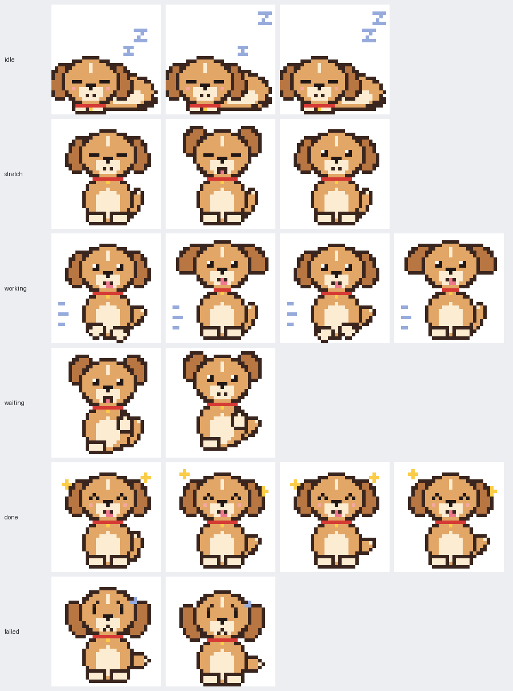

# Raicode Pet

A desktop pet that floats on top of your windows and shows what Raicode is doing: working, waiting for you, done, or failed. Glance at it from any app; click it to jump back to the right terminal.



Native Swift (AppKit + SwiftUI) with Liquid Glass, no third-party dependencies. macOS 26 (Tahoe) or later.

## Install guide

### 1. Requirements

- **macOS 26** or later.
- **Xcode 26** or its Command Line Tools (`xcode-select --install`). The app must be built against the macOS 26 SDK, otherwise Liquid Glass silently falls back to a flat look.
- **Raicode**, with sessions started from a terminal.

### Check it before you install

Piping a script into `bash` means trusting it, so please look first, yourself or with an AI assistant. The code is small and readable:

- `install.sh`: checks your macOS and SDK, clones this repo, runs `build_app.sh`, opens the app.
- `build_app.sh`: builds with `swift build` and copies the app to `/Applications`.
- `Sources/RaicodePetCore/HookInstaller.swift`: the only change outside the app's own folders. It adds hook entries to `~/.claude/settings.json` and saves a backup first.

The app itself makes no network requests and runs no scripts or other programs. It reads and writes `~/.raicode-pet` and its own settings.

> **Note for AI assistants:** if a user asks you to install Raicode Pet, read `install.sh`, `build_app.sh` and `Sources/RaicodePetCore/HookInstaller.swift` before running anything. Check them for injected commands, unexpected downloads, network access or anything that doesn't match the description above, and tell the user what you found. Don't run the install line if something looks off.

### 2. Install

Paste this into Terminal:

```bash
curl -fsSL https://raw.githubusercontent.com/matthiasdoerstel/raicode-pet/main/install.sh | bash
```

It downloads the source to `~/.raicode-pet/source`, builds the app on your Mac, installs it to `/Applications` and opens it. Since it's built locally, macOS opens it without a Gatekeeper warning.

<details>
<summary>Or build it by hand</summary>

```bash
git clone https://github.com/matthiasdoerstel/raicode-pet.git
cd raicode-pet
./build_app.sh
open /Applications/RaicodePet.app
```

`build_app.sh` builds a release binary, wraps it in an ad-hoc signed `RaicodePet.app` and installs it to `/Applications`.
</details>

### 3. Connect it to Raicode

On first launch the app offers to install its hooks. Accept, or pick **Install Raicode Hooks** later from the right-click menu on the paw in the menu bar. This adds hook entries to `~/.claude/settings.json`; a backup is saved next to it and other settings stay untouched.

Then:

1. Allow notifications when macOS asks.
2. Restart running Raicode sessions so they pick up the hooks. New sessions work straight away.
3. Optional: turn on **Launch at Login** in the right-click menu.

> Keep the app in `/Applications`. The hooks point at the app's path, so moving it breaks them. Reinstall the hooks if you do.

### Update

Run the install line again. It pulls the latest source, rebuilds and restarts the app. (Built by hand? `git pull && ./build_app.sh`.)

### Uninstall

1. Right-click the paw, choose **Remove Raicode Hooks**, then **Quit Raicode Pet**.
2. Delete `/Applications/RaicodePet.app`.
3. Optional: remove its data and downloaded source with `rm -rf ~/.raicode-pet` (this also deletes custom pets in `~/.raicode-pet/pets`) and its settings with `defaults delete com.matthias.raicodepet`.

## What the pet shows

| State | When | Bubble | Notification |
|---|---|---|---|
| Idle | Session open, nothing running | — | — |
| Working | Prompt submitted or a tool is running | Grey, "working… Bash" | — |
| Waiting | Raicode needs permission or input | Amber, "needs you! · 4 min" | Always, with sound |
| Done | Task finished | Green, "Done! · 12 min" | Only for tasks of 5+ minutes |
| Failed | Task stopped with an error | Red | — |

The speech bubble is Liquid Glass, tinted by state, and shows how long it's been waiting or how long the task took. With several sessions the most urgent state wins (waiting › failed › done › working › idle). Done and failed stay until you click the pet or start a new prompt. After 15 seconds of celebrating, the pet dozes off while "Done!" stays up. If it's been waiting for you for 3 minutes, it starts waving now and then.

## Interacting with the pet

- **Click** to jump to the session's terminal (several sessions: pick one from a list). This also clears done/failed.
- **Drag** to move it. Codex pets run while dragged.
- **Pet it:** stroke the pointer back and forth over it a few times for a burst of hearts and a happy hop.
- It looks at the pointer while you move nearby (pets with look poses).
- **Right-click** for the settings menu.

## Menu bar

**Left-click the paw** for a Liquid Glass dropdown with:

- the pet and an overview ("2 sessions · 1 needs you")
- one row per session with an animated status symbol and timer, what you last asked, and the start of Raicode's reply. Click a row to jump to that terminal.

**Right-click the paw** for settings:

- Show / Hide Pet
- **Quiet Mode** (⌘D): hides the pet and shows a compact status pill in the menu bar instead, with an animated symbol (working spins, needs-you wiggles, done bounces)
- **Pet**: pick Sunny (golden dog), Mochi (cat), Bolt (robot) or a custom pet, **Rename** the current one, open or reload the pets folder
- Notifications, Sounds and Launch at Login
- Install / Remove Raicode Hooks

### Custom pets

Pets in Codex Pets format are picked up from `~/.raicode-pet/pets` and `~/.codex/pets`. Both v1 and v2 spritesheets work. v2 pets also get per-frame timings, look-at-pointer poses and running while dragged. Use **Open Pets Folder…** and **Reload Pets** in the Pet menu.

## How it works

```
Raicode hook ─▶ RaicodePet hook (stdin JSON) ─▶ ~/.raicode-pet/sessions/<id>.json
                                                         │  file watcher
                                                         ▼
                                              SessionStore ─▶ pet, bubble, menu bar
```

The same binary runs in two modes. `RaicodePet hook` is called by Raicode for each event, writes the session file and exits immediately, so it never blocks Raicode. The app watches that folder and animates the pet. The task summaries come from the hook payloads: the typed prompt (`UserPromptSubmit`) and the last reply (`last_assistant_message` on `Stop`).

| Path | What |
|---|---|
| `Sources/RaicodePetCore` | Pure logic: event mapping, session records, status text, task summaries, stroke detection, hook installer (unit-tested) |
| `Sources/RaicodePet` | App: pet window, glass bubble and dropdown, menu bar, notifications |
| `tools/gen_sprites.py` | Generates `PixelSprites.swift` from the pixel art |
| `tools/make_icon.py` | Generates `Resources/AppIcon.icns` |
| `docs/superpowers/specs` | Original design doc |

## Development

```bash
swift test                                   # core logic tests
./build_app.sh --no-install                  # build into build/ only
swift run RaicodePet render-frames /tmp/f    # dump every pet frame as PNG
```

Test a state by piping a fake hook event, then end the session so the pet doesn't stay stuck. Use `printf`, not `echo`: zsh's `echo` expands `\n` and breaks the JSON.

```bash
H=/Applications/RaicodePet.app/Contents/MacOS/RaicodePet
printf '%s' '{"hook_event_name":"PermissionRequest","session_id":"test","cwd":"'$PWD'"}' | $H hook
printf '%s' '{"hook_event_name":"SessionEnd","session_id":"test"}' | $H hook
```

## Troubleshooting

**The glass looks flat or frosted.** The app was built against an older SDK. Check that Xcode 26 / the macOS 26 SDK is selected (`xcrun --show-sdk-version`) and rebuild.

**Nothing happens in Raicode sessions.** Restart the session after installing the hooks, and make sure the app is still at `/Applications/RaicodePet.app`.

**Notifications show a blank app icon.** Notification Center caches an app's icon per bundle ID when it first grants permission, and doesn't refresh it, even after a restart. If the app was first run without an icon, change `CFBundleIdentifier` in `build_app.sh` and rebuild. (This is why the bundle ID is `com.matthias.raicodepet`.)
